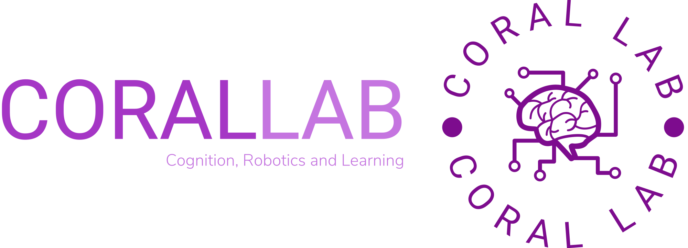

# UMBC's Cognition, Robotics, and Learning (CoRaL) Lab

## Principal Investigator
 1. [Dr. Tim Oates](https://www.linkedin.com/in/tim-oates-78a92/)

## Current Members (Alphabetically)
### PhD Students
 1. [Akash Vartak](https://www.linkedin.com/in/akash-vartak/)
 1. [Aydin Ayanzadeh](https://www.linkedin.com/in/ayanzadeh93/)
 1. [Chi Zhang](https://www.linkedin.com/in/chi-zhang-7b91a173/)
 1. [Duong Ta](https://www.linkedin.com/in/duong-ta-16a631162/)
 1. [Omkar Kulkarni](https://www.linkedin.com/in/omkar-kulkarni-33541ab9)
 1. [Prakhar Dixit](https://in.linkedin.com/in/prakhar-dixit-712751149)
 1. [Sadia Kamal](https://www.linkedin.com/in/sadia-kamal-a63059b4/)
 1. [Shalima Binta Manir](https://www.linkedin.com/in/shalima-binta-manir-675a8532b/)

---

## Graduates
1. [Anjali Bhatt (MS)](https://www.linkedin.com/in/bhatt-anjali/)
1. [Khondoker Hossain (PhD)](https://www.linkedin.com/in/khondokerhossain/)
1. [Abhishikta Bandyopadhyay (PhD)](https://www.linkedin.com/in/abhishikta-bandyopadhyay-471050191/)
1. [Ashwinkumar Ganesan (PhD)](https://www.linkedin.com/in/gashwin/)
1. [Akshay Peshave (PhD)](https://www.linkedin.com/in/akshaypeshave/)
